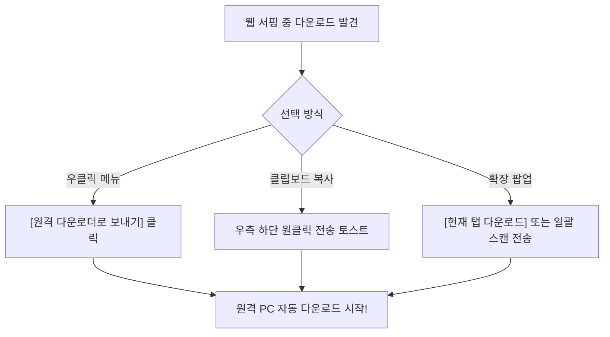

# 🚀 원격 다운로더 (Remote Downloader) `v0.1.71`

스마트폰(iPhone / Android)이나 외부 PC의 웹 브라우저에서 링크·마그넷·Base64 코드를 전송하면, 서버 PC에서 해당 파일을 자동으로 해석하고 고속 다운로드해 주는 파이썬 기반 원격 다운로드 센터입니다.

---

## 📑 목차 (Table of Contents)
- [⚡ 빠른 시작 (Quick Start)](#-빠른-시작-quick-start)
- [✨ 주요 기능](#-주요-기능)
- [🌐 지원 서비스 목록](#-지원-서비스-목록)
- [🛠 설치 및 상세 실행 방법](#-설치-및-상세-실행-방법)
  - [방법 1. Windows 단일 실행 파일 (.exe 무설치)](#방법-1-windows-단일-실행-파일-exe-무설치)
  - [방법 2. 파이썬 소스 코드 직접 실행](#방법-2-파이썬-소스-코드-직접-실행)
  - [방법 3. 도커(Docker) 및 시놀로지 NAS (Container Manager)](#방법-3-도커docker-및-시놀로지-nas-container-manager)
- [🧩 크롬 확장 프로그램 (Chrome Extension)](#-크롬-확장-프로그램-chrome-extension)
- [📱 스마트폰 원격 다운로드 연동](#-스마트폰-원격-다운로드-연동)
  - [🍎 아이폰 / iPad (단축어 공유 시트)](#1--아이폰--ipad-단축어-공유-시트-원터치-전송)
  - [🤖 안드로이드 (북마클릿 & HTTP Shortcuts)](#2--안드로이드-설정-북마클릿--http-shortcuts-공유-메뉴)
  - [🌐 외부(LTE / 5G) 원격 접속](#3--외부lte--5g-원격-접속-방법)
- [🧪 개발 및 테스트](#-개발-및-테스트)

---

## ⚡ 빠른 시작 (Quick Start)

가장 빠르게 원격 다운로더를 시작하는 3단계 방법입니다.


### 1단계: 실행하기
- **Windows 사용자 (가장 간단한 방법)**:
  - [GitHub 최신 릴리즈](https://github.com/x220volt/RmtDownloader/releases/latest)에서 `RemoteDownloader.exe`를 다운로드하여 더블 클릭합니다.
  - 또는 소스 코드를 내려받은 경우 [run.bat](file:///c:/_coding/remote_downloader/run.bat)을 실행합니다.

### 2단계: 웹 대시보드 열기
- 브라우저를 열고 **`http://localhost:7971`** 로 접속합니다.
- **초기 로그인 정보**:
  - **아이디**: `admin`
  - **비밀번호**: `password1234`
  *(로그인 후 우측 상단 ⚙️ 설정 ➔ 🔒 보안 탭에서 비밀번호를 즉시 변경할 수 있습니다.)*

### 3단계: 다운로드 시작
- 웹 대시보드 입력창에 **일반 URL, 구글 드라이브, 메가, 토렌트/마그넷, 네이버 카페, 또는 암호가 섞인 Base64 텍스트**를 그대로 붙여넣고 **[다운로드 추가]**를 누르면 자동으로 해석되어 고속 다운로드가 시작됩니다!

> [!TIP]
> **크롬 확장 프로그램**을 추가하면 웹 서핑 중 마우스 우클릭 한 번으로 원격 PC에 즉시 다운로드를 보낼 수 있습니다. (아래 [크롬 확장 프로그램 안내](#-크롬-확장-프로그램-chrome-extension) 참조)

---

## ✨ 주요 기능

1. **반응형 웹 대시보드 & 모바일 웹앱 (PWA)**
   - PC는 물론 스마트폰(iOS / Android) 브라우저에 최적화된 반응형 UI.
   - 모바일 브라우저에서 **[홈 화면에 추가]** 시 독립 실행형 전체 화면 앱(PWA)으로 작동.
   - Server-Sent Events(SSE) 실시간 스트리밍으로 새로고침 없이 다운로드 속도, 진행률, 잔여 시간(ETA) 표시.

2. **지능형 링크 자동 해석 및 암호 자동 풀이**
   - 중첩된 Base64 링크, 본문 설명 텍스트와 비밀번호(`비번:1234`, `암호:xxxx` 등)가 섞인 복사글에서 다운로드 링크와 암호를 스스로 분리·인식.
   - Cloudflare Turnstile, 네이버 카페 회원 전용 세션, Google Drive 대용량 경고 자동 처리.

3. **초고속 분할 다운로드 & 토렌트 내장**
   - HTTP/HTTPS 멀티 커넥션 고속 분할 다운로드 엔진 (`aria2` 연동 지원).
   - `.torrent` 파일 드래그 앤 드롭 및 `magnet:?xt=` 마그넷 링크 완벽 지원.

---

## 🌐 지원 서비스 목록

| 분류 | 지원 서비스 및 프로토콜 |
| :--- | :--- |
| **클라우드 / 웹하드** | **Google Drive**, **MEGA** (실시간 AES 복호화), **TeraBox** (직접 다운로드 및 내 계정 클라우드 저장), **GoFile** (웹 토큰/비번 자동 풀이), **1fichier**, **Pixeldrain**, **MediaFire**, **kio.ac**, **Transfer.it**, **네이버 MYBOX** |
| **고속 호스팅 / 파일 공유** | **GigaFile** (dlkey 자동 처리), **VikingFile**, **MegaUp**, **X-Share**, **FileKeeper**, **DataNodes**, **Buzzheavier**, **Rootz** |
| **레트로 ROM / 아카이브** | **Romsfun**, **Romspure**, **PlanetEmu**, **WoWroms**, **Vimm's Lair**, **GitHub Releases & Archive** |
| **포털 & 블로그** | **네이버 카페** (회원 전용 첨부파일 및 게시글 탭 직링크 추출), **티스토리** (`kakaocdn`, `daumcdn` 첨부파일 분할 압축), **블로그스팟(Blogspot)** |
| **P2P & 공통** | **BitTorrent** (`.torrent`), **Magnet** (`magnet:?`), **Direct File** (모든 직링크), **다중 중첩 Base64 인코딩 링크** |

---

## 🛠 설치 및 상세 실행 방법

### 방법 1. Windows 단일 실행 파일 (.exe 무설치)
1. [GitHub Releases](https://github.com/x220volt/RmtDownloader/releases/latest)에서 최신 버전의 `RemoteDownloader.exe`를 다운로드합니다.
2. 별도의 Python 설치 없이 더블 클릭하여 바로 실행합니다.

### 방법 2. 파이썬 소스 코드 직접 실행
1. Python 3.10 이상이 설치된 환경에서 저장소를 복제하거나 다운로드합니다.
2. 가상환경 생성 및 의존성 패키지 설치:
   ```bash
   pip install -r requirements.txt
   ```
3. 서버 실행:
   - Windows: [run.bat](file:///c:/_coding/remote_downloader/run.bat) 더블 클릭
   - CLI 직접 실행:
     ```bash
     python app.py
     ```
   - 기본 포트: `7971` (`http://localhost:7971`)

### 방법 3. 도커(Docker) 및 시놀로지 NAS (Container Manager)
시놀로지 NAS, QNAP, Unraid 또는 Linux 서버에서 Docker Compose로 간편하게 구동할 수 있습니다.

#### `docker-compose.yml`
```yaml
version: '3.8'

services:
  remote-downloader:
    container_name: remote-downloader
    build: .
    image: remote-downloader:latest
    restart: unless-stopped
    ports:
      - "7971:7971"
    environment:
      - PUID=1000          # 호스트 사용자 UID (시놀로지 SSH에서 id 명령어로 확인)
      - PGID=1000          # 호스트 사용자 GID
      - TZ=Asia/Seoul
      - UMASK=022
      - CONFIG_DIR=/config
      - DOWNLOAD_DIR=/downloads
    volumes:
      - ./config:/config       # 설정 및 작업 큐 보관 경로
      - ./downloads:/downloads # 실제 다운로드 파일 저장 폴더
    shm_size: "512mb"          # 헤드리스 브라우저 메모리 공간 권장
```

```bash
# 빌드 및 백그라운드 구동
docker compose up -d --build
```

---

## 🧩 크롬 확장 프로그램 (Chrome Extension)

브라우징 중 클릭 한 번으로 원격 서버에 다운로드를 지시할 수 있는 전용 확장 프로그램입니다.



1. **설치 방법**:
   - 저장소 내 [`extension/`](file:///c:/_coding/remote_downloader/extension) 폴더를 준비하거나, 웹 대시보드 **⚙️ 설정 ➔ 🧩 크롬 확장** 탭에서 `RemoteDownloader-Extension.zip`을 다운로드해 압축을 해제합니다.
   - Chrome 주소창에 `chrome://extensions` 입력 ➔ 우측 상단 **[개발자 모드]** 켜기 ➔ **[압축해제된 확장 프로그램을 로드합니다]** 클릭 후 `extension` 폴더를 선택합니다.
2. **연동 설정**:
   - 확장 프로그램 아이콘 클릭 ➔ **[⚙️ 서버 및 계정 설정]**에서 서버 주소(`http://127.0.0.1:7971` 또는 원격 IP)와 아이디/비밀번호를 입력하고 저장합니다.
3. **주요 기능**:
   - **우클릭 메뉴**: 링크 또는 드래그한 텍스트 위에서 **[원격 다운로더로 보내기]**.
   - **스마트 복사 감지**: 지원 서비스 링크나 Base64 복사 시 화면 우측 하단에 미니 토스트 알림으로 즉시 전송 버튼 제공.
   - **페이지 내 첨부파일 일괄 스캔**: 네이버 카페, 블로그스팟, 티스토리 게시글의 첨부파일 링크를 팝업에서 목록화하여 원클릭 일괄 전송.
   - **RetroDB 연동**: 한글패치 링크 클릭 시 전용 하위 폴더명을 1회성으로 자동 지정하여 다운로드.

---

## 📱 스마트폰 원격 다운로드 연동

외부나 모바일 기기에서도 웹 대시보드 우측 상단 **⚙️ 설정 ➔ 📱 스마트폰 가이드** 탭의 주소와 API 토큰을 복사하여 즉시 활용할 수 있습니다.

### 1) 🍎 아이폰 / iPad (단축어 공유 시트 원터치 전송)
1. **[단축어]** 앱 실행 ➔ **`+`** (새 단축어 생성) ➔ 하단 **`(i)` 정보**에서 **[공유 시트에서 보기]** 활성화.
2. **[동작 추가]** ➔ **`URL의 콘텐츠 가져오기`** 추가 (GET 방식).
3. URL 입력란에 아래 주소를 입력:
   ```text
   http://<서버IP>:7971/add?token=<API토큰>&url=[단축어 입력]
   ```
   *(끝부분의 `[단축어 입력]`에 키보드 상단의 파란색 변수 **'단축어 입력'**을 지정합니다.)*
4. 사파리나 웹 서핑 중 **[공유] ➔ 생성한 단축어 선택**만으로 서버 PC에 즉시 다운로드가 예약됩니다.

### 2) 🤖 안드로이드 설정 (북마클릿 & HTTP Shortcuts 공유 메뉴)
- **북마클릿 (앱 설치 불필요)**:
  - 브라우저 북마크 생성 후 URL에 대시보드의 **스마트폰 가이드 북마클릿 자바스크립트 코드**를 저장하면, 터치 한 번으로 현재 페이지나 선택 텍스트가 PC로 전송됩니다.
- **[공유] 메뉴 연동 (`HTTP Shortcuts` 앱 활용)**:
  - Play 스토어에서 무료 오픈소스 앱 **HTTP Shortcuts** 설치 ➔ 새 바로가기 생성.
  - Method: `GET`, URL: `http://<서버IP>:7971/add?token=<API토큰>&url={text}`
  - **Share into shortcut** 옵션을 활성화하면 모든 앱의 [공유] 메뉴에서 백그라운드로 즉시 전송할 수 있습니다.

### 3) 🌐 외부(LTE / 5G) 원격 접속 방법
- **Tailscale (가장 추천)**:
  - 서버 PC와 스마트폰에 무료 **Tailscale** 앱을 설치하고 로그인하면 부여되는 고유 가상 IP(`http://100.x.x.x:7971`)로 포트포워딩 없이 외부 어디서나 안전하게 접속할 수 있습니다.
- **공유기 포트포워딩 / DDNS**:
  - 공유기 설정에서 `7971` 포트를 서버 PC로 포워딩하여 도메인 또는 외부 IP로 연결합니다.

---

## 🧪 개발 및 테스트

```powershell
# 전체 단위 및 회귀 테스트 실행 (오프라인)
.\.venv\Scripts\python.exe -m unittest discover -s tests -v

# 패키징 빌드 및 릴리즈 (버전 올리기 + GitHub Release 원클릭)
.\.venv\Scripts\python.exe build.py --bump --release
```

- 전체 버전별 세부 변경 기록은 [CHANGELOG.md](file:///c:/_coding/remote_downloader/CHANGELOG.md)를 참고하세요.
